  
  
  

## About me

I'm a **Flutter Developer at InTheKloud**, building production fintech and e-commerce apps for iOS and Android: live gold prices streamed over **SignalR**, **Paymob** and **SkipCash** payments, and merchant tools people use every day. I take features from the first commit to **App Store** and **Google Play** releases, and my **C# / .NET** backend experience means I speak the API team's language.

- **Currently:** Flutter Developer @ InTheKloud (fintech & e-commerce)
- **Focus:** Clean Architecture · BLoC / Cubit · real-time with SignalR · payments
- **Backend:** C# · .NET · ASP.NET Core · SQL Server
- **Open to:** full-time & freelance Flutter work
- **Based in:** Egypt · Arabic (native) · English (professional)

## Featured work

*I had the pleasure of building these production apps. Both are commercial, closed-source client projects; full case studies are on [my portfolio](https://osamamohamedr1.web.app/#works).*

<table>
  <tr>
    <td width="50%" valign="top">
      
      
<code>01 / 02</code>&nbsp; Fintech · Qatar

      <h3>Value Gold</h3>
      
<b>Gold e-commerce &amp; investment platform</b> 
      Lets customers track live gold prices and buy, sell or invest in digital and physical gold with confidence.

      <ul>
        <li>Live buy / sell rates across purities, streamed with <b>SignalR</b></li>
        <li>Digital-to-physical gold, gifting and a wallet with <b>SkipCash</b></li>
        <li>KYC onboarding, <b>Sign in with Apple</b>, Social Login, Arabic / English</li>
      </ul>
      
<code>Flutter</code> <code>BLoC/Cubit</code> <code>SignalR</code> <code>SkipCash</code> <code>Apple Sign-In</code>

      <a href="https://osamamohamedr1.web.app/#works"><b>View case study →</b></a>
    </td>
    <td width="50%" valign="top">
      
      
<code>02 / 02</code>&nbsp; E-commerce · SaaS

      <h3>Vtreena Merchant</h3>
      
<b>Merchant management &amp; e-commerce platform</b> 
      Gives merchants a single app to run daily operations: catalog, orders, shipments, invoicing and payment collection.

      <ul>
        <li>Products, orders and shipment tracking with real-time status updates</li>
        <li>Subscriptions and one-time billing via <b>Paymob</b> with WebView checkout</li>
        <li>Arabic / English with RTL ↔ LTR, shipped to the <b>App Store</b> &amp; <b>Google Play</b></li>
      </ul>
      
<code>Flutter</code> <code>Clean Architecture</code> <code>Paymob</code> <code>WebView</code> <code>RTL</code>

      <a href="https://osamamohamedr1.web.app/#works"><b>View case study →</b></a>
    </td>
  </tr>
</table>

## Tech stack

*I am striving to never stop learning and improving.*

  

<table>
  <tr>
    <td width="50%" valign="top">
      <code>// Flutter &amp; Architecture</code>  
      
      
      
      
      
      
      
      
    </td>
    <td width="50%" valign="top">
      <code>// Languages &amp; Principles</code>  
      
      
      
      
    </td>
  </tr>
  <tr>
    <td width="50%" valign="top">
      <code>// Networking &amp; Real-Time</code>  
      
      
      
      
      
      
    </td>
    <td width="50%" valign="top">
      <code>// Auth &amp; Payments</code>  
      
      
      
      
      
    </td>
  </tr>
  <tr>
    <td width="50%" valign="top">
      <code>// Platform &amp; Storage</code>  
      
      
      
      
      
      
      
      
      
    </td>
    <td width="50%" valign="top">
      <code>// Release &amp; Tooling</code>  
      
      
      
      
      
      
      
      
    </td>
  </tr>
  <tr>
    <td colspan="2" valign="top">
      <code>// Backend</code>  
      
      
      
      
      
      
      
      
      
      
    </td>
  </tr>
</table>

## Experience

*Where I've been building, and where I learned.*

<table>
  <tr>
    <td width="96" align="center" valign="top"></td>
    <td valign="top">
      <b>Flutter Developer @ InTheKloud</b> 
      Nov 2025 – Present · Flutter · BLoC · Clean Architecture
      <ul>
        <li><b>Vtreena Merchant:</b> end-to-end catalog, orders &amp; tracking, shipments, invoices, subscription invoicing and collections; recurring and one-time billing with Paymob, including WebView/iframe checkout.</li>
        <li><b>Value Gold:</b> live gold pricing streamed with SignalR, purity- and quantity-based buy &amp; sell workflows, SkipCash payments, Social Login and Sign in with Apple.</li>
      </ul>
    </td>
  </tr>
  <tr>
    <td align="center" valign="top"></td>
    <td valign="top">
      <b>B.Sc. Electronics &amp; Communication Engineering</b> 
      Faculty of Engineering, Mansoura University · 2020 – 2025 · Grade: Excellent
    </td>
  </tr>
</table>

<!-- Personal projects (hidden — remove this comment wrapper to show again)

## Personal projects

<table>
  <tr>
    <td width="50%" valign="top">
      <h4>Nutrix</h4>
      Graduation project · Jul 2025 
      AI-generated personalized fitness &amp; nutrition plans.  
      
      
    </td>
    <td width="50%" valign="top">
      <h4>FinWise</h4>
      Sep 2025 
      Personal finance tracking with analytics.  
      
      
    </td>
  </tr>
  <tr>
    <td width="50%" valign="top">
      <h4>Wdaker</h4>
      Jul 2025 
      Islamic companion with daily guidance and a mosque finder.  
      
      
    </td>
    <td width="50%" valign="top">
      <h4>E-Shop</h4>
      Oct 2024 
      E-commerce app with product management and a shopping cart.  
      
    </td>
  </tr>
</table>

-->

## Contact

*I'm currently available for full-time & freelance Flutter work.* Reach me at **osamamohamedr1@gmail.com**.

  
  
  

